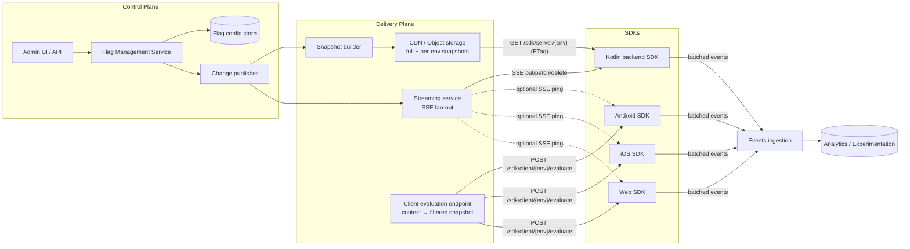
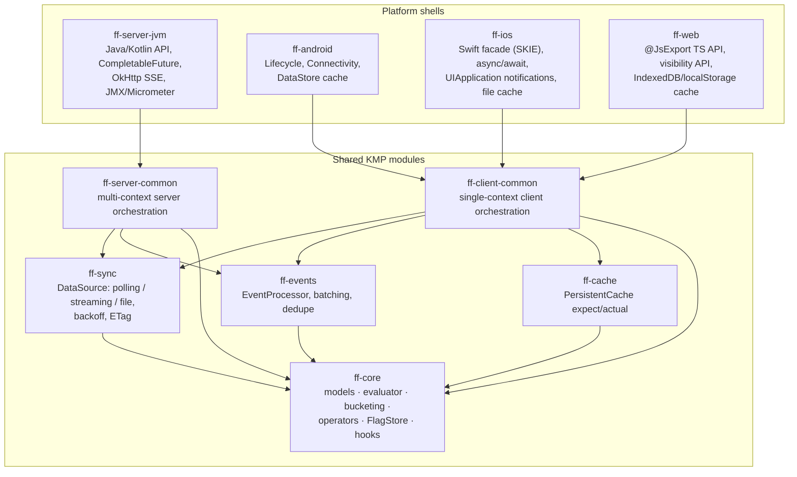
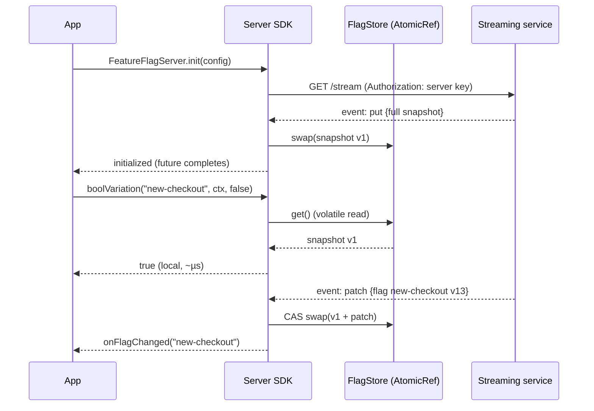
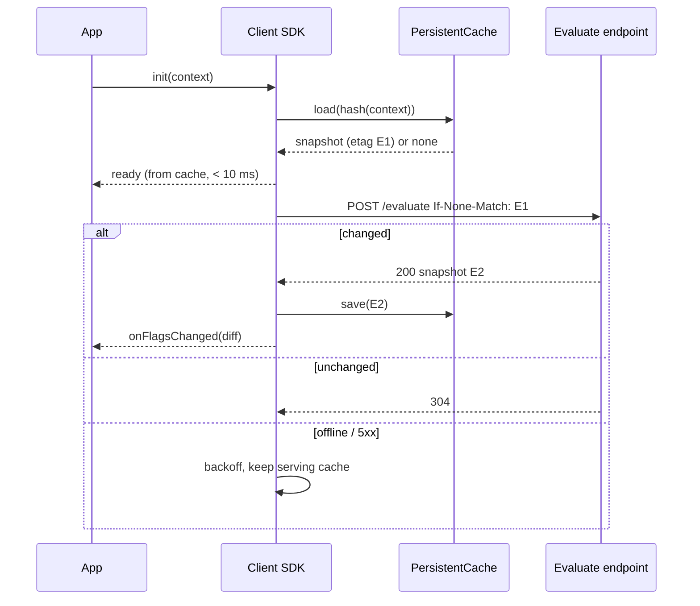

# High-Level Design — Universal Feature Flag SDK

| | |
|---|---|
| **Status** | Draft for review |
| **Owner** | keshavop |
| **Last updated** | 2026-10-27 |
| **Related** | [LLD](./lld.md) · [Implementation plan](./implementation-plan.md) · [ADRs](./adr/) |

---

## 1. Problem statement

Product teams need to ship code dark, roll features out gradually, run experiments and kill misbehaving
features instantly — on **Web, Android, iOS and Kotlin backend services** — with one consistent mental model
and one evaluation semantics.

The two families of consumers have opposite constraints:

| | Client SDKs (Web / Android / iOS) | Server SDK (Kotlin / JVM) |
|---|---|---|
| Users per process | 1 (the device user) | Millions (any request) |
| Evaluation location | Local, from a downloaded snapshot | Local, from full rule set in memory |
| Hot path budget | < 50 µs, never blocks UI thread | < 1 µs p99, lock-free, 100k+ eval/s/core |
| Network | Flaky, metered, offline is normal | Reliable, long-lived connections OK |
| Update propagation | Seconds–minutes acceptable (≤ 30 s foreground) | Sub-second (≤ 1 s) |
| Trust boundary | Untrusted device — must not leak other users' targeting | Trusted — may hold all rules & segments |
| Lifecycle | Background/foreground, process death | Long-running, graceful shutdown |

## 2. Goals and non-goals

### Goals
1. **Zero-latency evaluation** — no network I/O on the evaluation path, on any platform.
2. **Identical semantics** — the same flag + context yields the same variation on every platform
   (enforced by a shared conformance suite).
3. **Never throw, never block** — evaluation always returns a value (the caller's default on any error).
4. **Offline-first clients** — last-known-good snapshot is persisted and used at cold start.
5. **Real-time backend** — streaming updates with automatic fallback to polling.
6. **High throughput, thread-safe backend** — lock-free reads, safe concurrent updates.
7. **Small footprint** — Android AAR < 300 KB, iOS framework < 1.5 MB, Web bundle < 25 KB gzipped (core).
8. **Observability** — exposure events, evaluation hooks, SDK health metrics.

### Non-goals (v1)
- The flag management service / admin UI itself (the SDK consumes a documented contract; see §7).
- Experiment statistics / analysis (SDK only emits exposure & custom events).
- Edge / CDN-worker SDK (possible later on the same core; JS target makes it cheap).

## 3. Functional requirements

| ID | Requirement |
|---|---|
| FR-1 | Typed variations: `Boolean`, `String`, `Int`, `Double`, `JSON`. |
| FR-2 | Targeting: individual targets, attribute rules (equals, in, contains, startsWith, regex, semver, number/date compare), segment membership, prerequisites. |
| FR-3 | Percentage rollouts & experiments with deterministic, sticky bucketing on any context attribute. |
| FR-4 | Multi-kind evaluation context (user, device, organization, …) with private attributes. |
| FR-5 | Evaluation detail (`value`, `variationIndex`, `reason`) for debugging & analytics. |
| FR-6 | Change listeners (per flag and global). |
| FR-7 | Client: `identify(context)` to switch user; bootstrap from embedded/server-provided values. |
| FR-8 | Exposure & custom event tracking with batching and de-duplication. |
| FR-9 | Offline mode & test/local-file data source for unit tests. |
| FR-10 | Hooks (before/after evaluation) for logging, tracing, OpenTelemetry. |

## 4. Non-functional requirements

| Attribute | Target |
|---|---|
| Server eval latency | p99 < 1 µs (warm, simple rule), no allocation on happy path where feasible |
| Client eval latency | p99 < 50 µs |
| Server throughput | ≥ 100k evaluations / s / core, linear scaling across cores |
| Propagation | Server ≤ 1 s (streaming); client ≤ 30 s foreground (polling) / ≤ 2 s (optional streaming) |
| Availability | SDK functions with 100 % outage of the flag service (stale or default values) |
| Init time | Client: cached snapshot served < 10 ms after `init`; server: `init` waits ≤ configurable timeout (default 5 s) |
| Memory | Server: O(flags + segments); 10k flags ≈ < 50 MB. Client: < 1 MB typical |
| Battery / data | Client uses conditional requests (ETag) → 304 for unchanged snapshots |
| Security | TLS only; separate key types; no PII in logs; private attributes stripped from events |
| Compatibility | Android minSdk 21, iOS 13+, evergreen browsers + ES2017, JVM 11+ |

## 5. System context



The SDK is the subject of this design. The control/delivery plane is shown only to fix the **contract**
the SDK depends on (§7).

## 6. SDK architecture

### 6.1 Approach: Kotlin Multiplatform shared core

One Kotlin codebase holds everything that defines *semantics* (models, evaluator, bucketing, rule operators,
serialization, sync state machine, event batching). Platform shells are thin and only adapt I/O, storage,
lifecycle and idiomatic APIs. See [ADR-001](./adr/ADR-001-kotlin-multiplatform-core.md).



Dependency rule: arrows point inward only. `ff-core` has **no** I/O dependencies (pure Kotlin + kotlinx.serialization),
which keeps it trivially testable and small.

### 6.2 Server-side SDK profile (Kotlin / JVM)

- **Full rule download**: the server SDK receives every flag & segment for its environment and evaluates
  any context locally ([ADR-002](./adr/ADR-002-local-evaluation-with-snapshots.md)).
- **Real-time sync**: SSE stream (`put` = full snapshot, `patch` = one flag/segment with version, `delete` = tombstone);
  on stream failure → exponential backoff with jitter and temporary polling fallback
  ([ADR-003](./adr/ADR-003-realtime-sync-sse-with-polling-fallback.md)).
- **Concurrency**: an immutable `Snapshot` held in an `AtomicReference`; readers do one volatile read and never lock;
  the single writer (data source) builds a new snapshot copy-on-write and CAS-swaps it
  ([ADR-005](./adr/ADR-005-backend-concurrency-model.md)).
- **Events**: evaluations enqueue into a bounded lock-free queue; a background coroutine aggregates summaries,
  de-duplicates exposures and flushes batches asynchronously. Back-pressure policy: drop & count, never block callers.
- **Lifecycle**: `init` blocks up to `startWaitMillis` (or returns a future), `close()` flushes and shuts down.

### 6.3 Client-side SDK profile (Android / iOS / Web)

- **Snapshot per context**: on `init`/`identify`, the SDK requests a snapshot **for this context only**.
  Default mode is *server-evaluated snapshot* (flag → variation map) so that targeting rules and segment lists
  (which may contain other users' identifiers) never reach the device. An optional *filtered-rules* mode ships
  rules that reference only the current context's attributes, enabling on-device re-evaluation after
  local attribute changes. Either way, evaluation is a local map lookup → zero network latency.
- **Persistent cache**: last-known-good snapshot per context hash (DataStore on Android, file in Application Support
  on iOS, IndexedDB with localStorage fallback on Web). Cold start serves the cache immediately
  (stale-while-revalidate), then refreshes in the background.
- **Refresh**: conditional `GET`/`POST` with `If-None-Match`; polling interval (default 5 min background-safe,
  30 s in foreground), refresh on foreground/visibility and on network regain; optional streaming "ping" channel.
- **Threading**: evaluations are synchronous and read from an in-memory immutable map; network & disk work happen
  on background coroutines; listeners are delivered on the main thread by default.
- **Lifecycle-aware**: pause polling/streaming in background, flush events when app backgrounds / page hides
  (`sendBeacon` on Web).

### 6.4 Shared evaluation semantics

Evaluation order (identical on every platform):

1. Flag missing → default, `reason = FLAG_NOT_FOUND`.
2. Flag off → `offVariation`, `reason = OFF`.
3. Prerequisites (recursive, cycle-safe) — any failing → `offVariation`, `reason = PREREQUISITE_FAILED`.
4. Individual targets → `reason = TARGET_MATCH`.
5. Rules in order; first matching rule's variation or rollout → `reason = RULE_MATCH(ruleId)`.
6. Fallthrough variation or rollout → `reason = FALLTHROUGH`.
7. Type mismatch / malformed → caller default, `reason = ERROR(kind)`.

Bucketing is deterministic: `murmur3_x86_32(flagKey + "." + salt + "." + bucketBy) mod 100_000`
([ADR-004](./adr/ADR-004-deterministic-bucketing-murmur3.md)), giving 0.001 % rollout granularity and
stickiness across platforms.

## 7. Delivery contract (what the SDK depends on)

| Endpoint | Used by | Notes |
|---|---|---|
| `GET /sdk/v1/server/{envKey}/snapshot` | Server | Full flags + segments; `ETag`; gzip |
| `GET /sdk/v1/server/{envKey}/stream` | Server | SSE: `put`, `patch`, `delete`, heartbeat comments every 30 s |
| `POST /sdk/v1/client/{clientKey}/evaluate` | Client | Body: context; returns evaluated snapshot; `ETag` |
| `GET /sdk/v1/client/{clientKey}/stream?ctx=` | Client (opt.) | SSE "ping"/"patch" for this context |
| `POST /sdk/v1/events/bulk` | All | Batched events, gzip, `X-SDK-Payload-Id` for idempotent retry |

Snapshot envelope (abridged — full schema in the [LLD](./lld.md#5-wire-formats)):

```json
{
  "schemaVersion": 1,
  "environment": "prod",
  "version": 18342,
  "flags":    { "new-checkout": { "key": "new-checkout", "version": 12, "on": true, "...": "..." } },
  "segments": { "beta-users":   { "key": "beta-users",   "version": 3,  "...": "..." } }
}
```

Every flag and segment carries a monotonically increasing `version`; SDKs ignore any patch whose version is ≤ the
stored one, making updates idempotent and order-safe.

## 8. Key data flows

### 8.1 Server init & real-time update



### 8.2 Client cold start (offline-safe)



### 8.3 Client `identify` (user switch)

Load cache for the new context hash → swap in-memory snapshot (or keep previous values until fresh data arrives,
configurable) → fetch → notify listeners with the diff. In-flight responses for the old context are discarded by
comparing a context generation counter.

## 9. Resilience & failure modes

| Failure | Behaviour |
|---|---|
| Flag service down at server start | `init` times out → SDK serves defaults (or local file fallback), keeps retrying; `isInitialized()` false |
| Stream drops | Reconnect with exponential backoff (1 s → 30 s cap, full jitter); after N failures, poll every 30 s until stream recovers |
| Corrupt payload | Reject whole payload, keep last good snapshot, emit `SdkError` metric |
| Unknown operator / newer schema | Rule evaluates to *no match* (fail closed) and logs once; schema major mismatch → keep cache |
| Event endpoint down | Retry once, then drop batch with counter; bounded memory |
| 401/403 | Stop retrying (invalid key), log error, serve cache/defaults |
| Client offline | Serve persisted snapshot; refresh on connectivity regain |
| Process death on mobile | Snapshot persisted; unsent events persisted best-effort (bounded) |

## 10. Security & privacy

- **Key types**: *server key* (secret, full rules) vs *client-side ID / mobile key* (public, can only fetch evaluated
  values for the supplied context). Server keys must never be embedded in apps — enforced by key prefix check.
- TLS 1.2+ everywhere; optional certificate pinning hook on mobile.
- **Private attributes** (global or per-context) are used for evaluation but stripped from events.
- Client default mode never ships segment membership lists or other users' targets to devices.
- Logs never include context attribute values unless debug logging is explicitly enabled.

## 11. Observability

- **Hooks**: `beforeEvaluation` / `afterEvaluation` (OpenTelemetry span events, custom logging).
- **Metrics** (server via Micrometer adapter): `ff.eval.count{flag,reason}`, `ff.store.version`, `ff.stream.state`,
  `ff.stream.reconnects`, `ff.events.dropped`, `ff.payload.bytes`, `ff.update.latency`.
- **Data source status API**: `VALID | INITIALIZING | INTERRUPTED | OFF` with last error & timestamp, plus listener.
- **Diagnostic events** (opt-out): SDK version, platform, init duration, stream health.

## 12. Scalability considerations (delivery side)

- Server snapshots served from CDN with ETag → thousands of service instances bootstrap without hitting origin.
- SSE fan-out service is stateless behind a load balancer; patches are small (one flag). Heartbeats keep LBs from
  idling out connections.
- Client evaluation endpoint is stateless & horizontally scalable; responses cacheable per
  (env, context-hash, config-version).
- Events: SDK-side summarisation (counts per flag/variation/version) cuts volume by orders of magnitude versus
  raw evaluation events.

## 13. Versioning & compatibility

- SDKs follow SemVer; all platforms released from one version number (shared core).
- Wire `schemaVersion` (major): SDK refuses incompatible majors and keeps serving cache; new optional fields
  are ignored (`ignoreUnknownKeys = true`).
- Public API stability: `@ExperimentalFlagApi` opt-in annotation for unstable surface.

## 14. Risks & open questions

| Risk / question | Mitigation / owner |
|---|---|
| KMP iOS/JS binary size & Swift ergonomics | Measure in Phase 0 spike; SKIE for Swift; separate `ff-core` from Ktor-dependent modules |
| Kotlin/JS bundle size for Web | Keep `ff-web` I/O on browser `fetch` (no Ktor), enable DCE; fallback: TS shell over JS core |
| Regex operator divergence across platforms | Restrict to RE2-compatible subset; conformance tests on every target |
| Delivery-plane contract not built yet | SDK ships with file/test data source + contract test fixtures |
| Client filtered-rules mode leaks targeting logic | Off by default; documented privacy trade-off |

## 15. Architecture decisions

| ADR | Decision |
|---|---|
| [ADR-001](./adr/ADR-001-kotlin-multiplatform-core.md) | Kotlin Multiplatform shared core with thin platform shells |
| [ADR-002](./adr/ADR-002-local-evaluation-with-snapshots.md) | Local evaluation from snapshots; server gets full rules, clients get per-context evaluated snapshots |
| [ADR-003](./adr/ADR-003-realtime-sync-sse-with-polling-fallback.md) | SSE streaming with polling fallback; polling-first on clients |
| [ADR-004](./adr/ADR-004-deterministic-bucketing-murmur3.md) | MurmurHash3 32-bit bucketing over 100,000 buckets |
| [ADR-005](./adr/ADR-005-backend-concurrency-model.md) | Immutable snapshot + atomic reference swap; lock-free reads |
