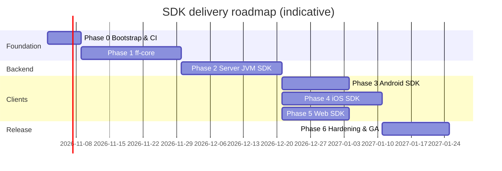

# Implementation Plan — Universal Feature Flag SDK

| | |
|---|---|
| **Status** | Draft for review |
| **Owner** | keshavop |
| **Last updated** | 2026-10-27 |
| **Related** | [HLD](./hld.md) · [LLD](./lld.md) · [ADRs](./adr/) |

Work is split into phases; each phase ends with a releasable, tested increment. Every PR is small, has a
conventional-commit title (`feat(core): …`, `docs: …`, `build: …`) and must keep CI green on all targets.

Phases 3–5 can run in parallel once `ff-client-common` lands (first PR of Phase 3).

---

## Phase 0 — Repository bootstrap (1 week)

**Scope:** Gradle KMP skeleton, tooling, CI, size spike.

| PR | Title | Contents |
|---|---|---|
| 0.1 | `build: bootstrap Gradle Kotlin Multiplatform project` | `settings.gradle.kts`, version catalog, `build-logic` convention plugins, empty modules |
| 0.2 | `ci: add GitHub Actions matrix for JVM, JS and iOS targets` | ubuntu (jvm/js/android unit), macos (ios sim) jobs; Gradle cache |
| 0.3 | `build: add ktlint, detekt and binary-compatibility-validator` | lint gates, `apiDump` for public API |
| 0.4 | `chore: size spike for ff-core on iOS and JS` | measure XCFramework & JS bundle; record in ADR-001 |

**Exit criteria:** `./gradlew build` green on all targets in CI; size numbers recorded.
**Risks:** macOS runner cost → run iOS job on `main` + labelled PRs only.

## Phase 1 — `ff-core` (3 weeks)

| PR | Title | Contents |
|---|---|---|
| 1.1 | `feat(core): add flag, segment and snapshot models` | serializable models, `ignoreUnknownKeys`, `UNKNOWN` operator |
| 1.2 | `feat(core): add EvaluationContext with multi-kind support` | builder, validation, private attrs, attribute path resolution |
| 1.3 | `feat(core): implement MurmurHash3 bucketing` | `Murmur3`, `Bucketer`, conformance vectors, distribution test |
| 1.4 | `feat(core): implement clause operators` | string/number/date/semver/regex operators |
| 1.5 | `feat(core): implement evaluator with prerequisites, targets, rules and rollouts` | algorithm per LLD §4, reasons, typed accessors |
| 1.6 | `feat(core): add InMemoryFlagStore with atomic snapshot swap` | versioned upserts, tombstones, `ChangeSet`, dependency graph |
| 1.7 | `test(conformance): add shared conformance suite and runners` | `conformance/*.json`, runners on JVM/JS/iOS |
| 1.8 | `feat(core): add evaluation hooks and logger abstraction` | hooks, `Logger`, log-once |

**Exit criteria:** conformance suite passes identically on JVM, JS and iOS simulator; ≥ 90 % line coverage on `ff-core`.

## Phase 2 — Server JVM SDK (3 weeks)

| PR | Title | Contents |
|---|---|---|
| 2.1 | `feat(sync): add DataSource abstraction, backoff and polling source` | ETag polling, status flow |
| 2.2 | `feat(sync): add SSE streaming data source with polling fallback` | parser, state machine (LLD §7.1) |
| 2.3 | `feat(events): add EventProcessor with summaries and exposure dedupe` | bounded channel, batching, gzip sender |
| 2.4 | `feat(server): add FeatureFlagServerClient public API` | Java-friendly API, `create`/`createAsync`, `allFlagsState` |
| 2.5 | `feat(sync): add File and Test data sources` | local dev + consumer testing |
| 2.6 | `test(server): add lincheck, stress tests and JMH benchmarks` | CI perf gate |
| 2.7 | `feat(server): add Micrometer metrics adapter` | optional module |
| 2.8 | `docs(samples): add Ktor server sample` | end-to-end sample |

**Exit criteria:** JMH p99 < 1 µs for simple flag; ≥ 100k eval/s/core; lincheck passes; propagation < 1 s against
a mock SSE server; `close()` flushes events.

## Phase 3 — Android SDK (2 weeks)

| PR | Title | Contents |
|---|---|---|
| 3.1 | `feat(client): add ff-client-common orchestration` | client store, identify with generation counter, listeners, Flow |
| 3.2 | `feat(cache): add PersistentCache with Android DataStore actual` | LRU of contexts, atomic writes |
| 3.3 | `feat(android): add FeatureFlags Android entry point with lifecycle and connectivity` | foreground/background polling, main-thread listeners |
| 3.4 | `docs(samples): add Android Compose sample app` | |

**Exit criteria:** cached flags available < 10 ms after `init`; polling paused in background (Robolectric test);
AAR < 300 KB.

## Phase 4 — iOS SDK (3 weeks)

| PR | Title | Contents |
|---|---|---|
| 4.1 | `feat(cache): add iOS file-based PersistentCache actual` | Application Support, excluded from backup |
| 4.2 | `feat(ios): add XCFramework build and SKIE Swift facade` | async/await, AsyncSequence |
| 4.3 | `feat(ios): add app lifecycle and network path observers` | |
| 4.4 | `build(ios): publish via Swift Package Manager and CocoaPods` | binary target, checksum automation |
| 4.5 | `docs(samples): add SwiftUI sample app` | |

**Exit criteria:** XCTest suite + conformance on simulator green; framework < 1.5 MB; Swift API reviewed by iOS lead.

## Phase 5 — Web SDK (2 weeks)

| PR | Title | Contents |
|---|---|---|
| 5.1 | `feat(web): add browser fetch/EventSource transport` | no Ktor |
| 5.2 | `feat(cache): add IndexedDB/localStorage PersistentCache actual` | |
| 5.3 | `feat(web): add JS/TS public API with SSR bootstrap` | `@JsExport`, `.d.ts`, visibility handling, `sendBeacon` |
| 5.4 | `build(web): publish ESM/CJS npm package` | |
| 5.5 | `docs(samples): add web sample app` | |

**Exit criteria:** Playwright tests green; core bundle < 25 KB gz; bootstrap hydrates without flicker.

## Phase 6 — Hardening & GA (2 weeks)

| PR | Title | Contents |
|---|---|---|
| 6.1 | `feat: add data source status API and diagnostic events` | |
| 6.2 | `feat(otel): add OpenTelemetry hook module` | |
| 6.3 | `ci: add release pipeline for Maven Central, SPM and npm` | single version, signed artifacts |
| 6.4 | `docs: add getting-started guides and API reference site` | Dokka + platform guides |
| 6.5 | `chore: security review and threat model sign-off` | key handling, PII redaction |

**Exit criteria:** 1.0.0 published on all registries; docs site live; all NFRs in [HLD §4](./hld.md#4-non-functional-requirements) verified.

## Cross-cutting definition of done (every PR)

- [ ] CI green on all affected targets; no public API change without `apiDump` update.
- [ ] Unit tests for new logic; conformance vectors for any semantic change.
- [ ] No evaluation-path allocations or locks introduced (benchmarks for `ff-core` changes).
- [ ] Docs (KDoc + relevant design doc) updated.
- [ ] Conventional-commit PR title and a description with summary + test plan.

## Risk register

| Risk | Likelihood | Impact | Mitigation |
|---|---|---|---|
| KMP iOS/JS size exceeds budget | Medium | Medium | Phase 0 spike; split modules; TS shell fallback |
| Regex semantics differ per platform | Medium | High | RE2 subset + conformance tests |
| SSE blocked by customer proxies | Low | Medium | Automatic polling fallback |
| Delivery service not ready | Medium | Medium | File/Test data sources, mock servers, JSON-schema contract |
| macOS CI cost/flakiness | Medium | Low | Run iOS jobs selectively; cache Kotlin/Native toolchain |
