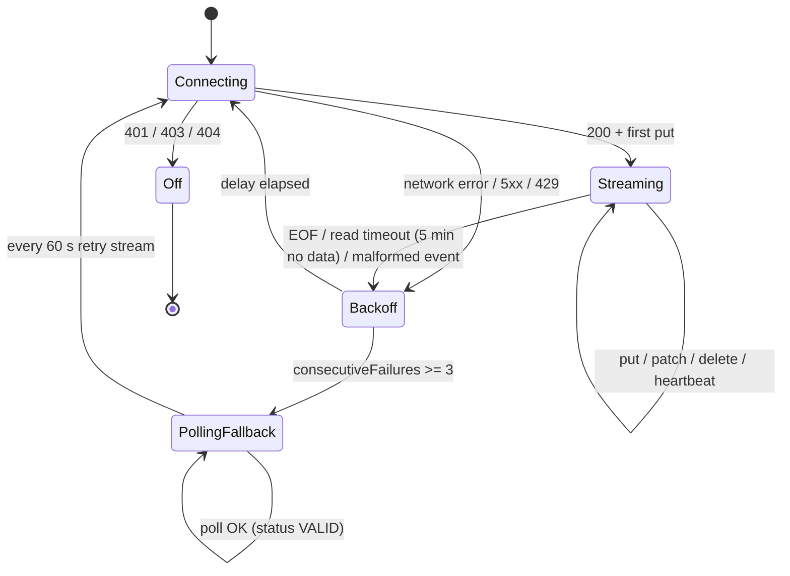

# Low-Level Design — Universal Feature Flag SDK

| | |
|---|---|
| **Status** | Draft for review |
| **Owner** | keshavop |
| **Last updated** | 2026-10-27 |
| **Related** | [HLD](./hld.md) · [Implementation plan](./implementation-plan.md) · [ADRs](./adr/) |

This document turns the [HLD](./hld.md) into concrete modules, types, algorithms and contracts. Code snippets
are normative for signatures and semantics, illustrative for implementation detail.

---

## 1. Repository & module layout

```
feature-flag-SDK/
├── settings.gradle.kts
├── build.gradle.kts
├── gradle/libs.versions.toml            # version catalog
├── build-logic/                         # convention plugins (kmp-library, publishing, lint)
├── ff-core/                             # pure semantics, no I/O
├── ff-sync/                             # DataSource implementations (polling, SSE, file)
├── ff-events/                           # EventProcessor
├── ff-cache/                            # PersistentCache expect/actual
├── ff-client-common/                    # single-context client orchestration (mobile + web)
├── ff-server-common/                    # multi-context orchestration (JVM)
├── ff-server-jvm/                       # public JVM/Java API, OkHttp transport, Micrometer
├── ff-android/                          # Android AAR (lifecycle, connectivity, DataStore)
├── ff-ios/                              # XCFramework + Swift facade (SKIE), SPM Package.swift
├── ff-web/                              # JS/TS export, npm package
├── conformance/                         # shared JSON test vectors + runners per target
├── benchmarks/                          # JMH (JVM) benchmarks
└── samples/                             # android-app, ios-app, web-app, ktor-server
```

### 1.1 Targets & source sets

| Module | commonMain | jvm | android | iosArm64 / iosSimulatorArm64 / iosX64 | js (IR, browser) |
|---|---|---|---|---|---|
| ff-core | ✔ | ✔ | ✔ | ✔ | ✔ |
| ff-sync | ✔ (interfaces, backoff, parsers) | OkHttp SSE | Ktor-OkHttp | Ktor-Darwin | browser `fetch` + `EventSource` |
| ff-events | ✔ | ✔ | ✔ | ✔ | ✔ |
| ff-cache | expect | file | DataStore | `NSFileManager` | IndexedDB / localStorage |
| ff-client-common | ✔ | – | ✔ | ✔ | ✔ |
| ff-server-common | – | ✔ | – | – | – |

### 1.2 Dependencies

| Library | Purpose | Modules |
|---|---|---|
| kotlinx-serialization-json | wire formats | core, sync, events |
| kotlinx-coroutines-core | async, dispatchers, `Mutex`, `Channel` | sync, events, client, server |
| kotlinx-atomicfu | multiplatform atomics | core |
| Ktor client (OkHttp / Darwin engines) | HTTP on mobile | sync (android, ios) |
| OkHttp + okhttp-sse | HTTP + SSE on JVM server | sync (jvm) |
| AndroidX Lifecycle, DataStore | lifecycle, cache | android |
| SKIE | Swift-friendly suspend/Flow/sealed interop | ios |
| Micrometer (optional, `compileOnly`) | metrics | server-jvm |

`ff-core` depends only on serialization + atomicfu (keeps iOS/JS size minimal).

## 2. Domain model (`ff-core`)

```kotlin
@Serializable
data class Snapshot(
    val schemaVersion: Int,
    val environment: String,
    val version: Long,
    val flags: Map<String, FlagConfig> = emptyMap(),
    val segments: Map<String, Segment> = emptyMap(),
) {
    companion object { val EMPTY = Snapshot(1, "", 0) }
}

@Serializable
data class FlagConfig(
    val key: String,
    val version: Long,
    val on: Boolean,
    val variations: List<JsonElement>,
    val offVariation: Int? = null,
    val prerequisites: List<Prerequisite> = emptyList(),
    val targets: List<Target> = emptyList(),
    val rules: List<Rule> = emptyList(),
    val fallthrough: VariationOrRollout,
    val salt: String,
    val trackEvents: Boolean = false,
    val deleted: Boolean = false,          // tombstone
)

@Serializable data class Prerequisite(val key: String, val variation: Int)
@Serializable data class Target(val contextKind: String = "user", val values: Set<String>, val variation: Int)

@Serializable
data class Rule(
    val id: String,
    val clauses: List<Clause>,             // AND semantics
    val variationOrRollout: VariationOrRollout,
)

@Serializable
data class Clause(
    val contextKind: String = "user",
    val attribute: String,                 // supports "/address/city" JSON-pointer style paths
    val op: Operator,
    val values: List<JsonPrimitive>,       // OR semantics across values
    val negate: Boolean = false,
)

@Serializable
enum class Operator {
    IN, NOT_IN, CONTAINS, STARTS_WITH, ENDS_WITH, MATCHES,          // string
    LESS_THAN, LESS_THAN_OR_EQUAL, GREATER_THAN, GREATER_THAN_OR_EQUAL, // number
    BEFORE, AFTER,                                                    // date (epoch ms or RFC3339)
    SEMVER_EQUAL, SEMVER_LESS_THAN, SEMVER_GREATER_THAN,
    SEGMENT_MATCH,
    @SerialName("unknown") UNKNOWN,        // forward-compat: unknown ops decode here → no match
}

@Serializable
data class VariationOrRollout(val variation: Int? = null, val rollout: Rollout? = null)

@Serializable
data class Rollout(
    val kind: RolloutKind = RolloutKind.ROLLOUT,
    val bucketBy: String = "key",
    val contextKind: String = "user",
    val weights: List<WeightedVariation>,  // ordered ranges; sum to 100_000; treatment first, control LAST (§4.4)
    val seed: Int? = null,                 // experiments: overrides flag key + salt
)
@Serializable enum class RolloutKind { ROLLOUT, EXPERIMENT }
@Serializable data class WeightedVariation(val variation: Int, val weight: Int)

@Serializable
data class Segment(
    val key: String,
    val version: Long,
    val included: Set<String> = emptySet(),
    val excluded: Set<String> = emptySet(),
    val rules: List<Rule> = emptyList(),
    val salt: String,
    val deleted: Boolean = false,
)
```

### 2.1 Evaluation context

```kotlin
class EvaluationContext private constructor(
    val kinds: Map<String, ContextKind>,    // "user" -> {...}, "device" -> {...}
) {
    val fullyQualifiedKey: String           // stable, used for cache keys and dedupe
    fun kind(kind: String): ContextKind?

    class Builder(kind: String = "user", key: String) {
        fun set(name: String, value: String): Builder
        fun set(name: String, value: Number): Builder
        fun set(name: String, value: Boolean): Builder
        fun set(name: String, value: JsonElement): Builder
        fun private(vararg attributes: String): Builder
        fun anonymous(value: Boolean): Builder
        fun build(): EvaluationContext
    }
    companion object {
        fun user(key: String) = Builder("user", key)
        fun multi(vararg contexts: EvaluationContext): EvaluationContext
    }
}

data class ContextKind(
    val kind: String,
    val key: String,
    val anonymous: Boolean,
    val attributes: Map<String, JsonElement>,
    val privateAttributes: Set<String>,
)
```

Contexts are immutable; validated on build (non-blank key, kind matches `[a-zA-Z0-9._-]+`, `kind != "multi"`).

### 2.2 Evaluation result

```kotlin
data class EvaluationDetail<T>(
    val value: T,
    val variationIndex: Int?,
    val reason: EvaluationReason,
)

sealed interface EvaluationReason {
    data object Off : EvaluationReason
    data object TargetMatch : EvaluationReason
    data class RuleMatch(val ruleIndex: Int, val ruleId: String, val inExperiment: Boolean) : EvaluationReason
    data class Fallthrough(val inExperiment: Boolean) : EvaluationReason
    data class PrerequisiteFailed(val prerequisiteKey: String) : EvaluationReason
    data class Error(val kind: ErrorKind) : EvaluationReason
}

enum class ErrorKind { CLIENT_NOT_READY, FLAG_NOT_FOUND, WRONG_TYPE, MALFORMED_FLAG, USER_NOT_SPECIFIED, EXCEPTION }
```

Reasons are preallocated singletons where possible (no allocation on `Off`, `TargetMatch`).

## 3. Public API

### 3.1 Server (JVM)

```kotlin
interface FeatureFlagServerClient : Closeable {
    fun boolVariation(key: String, context: EvaluationContext, default: Boolean): Boolean
    fun stringVariation(key: String, context: EvaluationContext, default: String): String
    fun intVariation(key: String, context: EvaluationContext, default: Int): Int
    fun doubleVariation(key: String, context: EvaluationContext, default: Double): Double
    fun jsonVariation(key: String, context: EvaluationContext, default: JsonElement): JsonElement

    fun boolVariationDetail(key: String, context: EvaluationContext, default: Boolean): EvaluationDetail<Boolean>
    // ... *Detail for every type

    fun allFlagsState(context: EvaluationContext, options: AllFlagsOptions = AllFlagsOptions.DEFAULT): FlagsState
    fun track(eventName: String, context: EvaluationContext, data: JsonElement? = null, metric: Double? = null)

    fun isInitialized(): Boolean
    val dataSourceStatus: DataSourceStatusProvider
    val flagTracker: FlagTracker                         // addFlagChangeListener / addFlagValueChangeListener
    fun flush()
    override fun close()                                 // flush + stop data source, idempotent
}

object FeatureFlagServer {
    @JvmStatic fun create(sdkKey: String, config: ServerConfig = ServerConfig.DEFAULT): FeatureFlagServerClient
    @JvmStatic fun createAsync(sdkKey: String, config: ServerConfig): CompletableFuture<FeatureFlagServerClient>
}
```

`allFlagsState` produces a client-bootstrap payload so server-rendered web pages can hydrate the Web SDK with
zero extra round-trips.

### 3.2 Client (shared by Android / iOS / Web)

```kotlin
interface FeatureFlagClient {
    fun boolVariation(key: String, default: Boolean): Boolean
    fun stringVariation(key: String, default: String): String
    fun intVariation(key: String, default: Int): Int
    fun doubleVariation(key: String, default: Double): Double
    fun jsonVariation(key: String, default: JsonElement): JsonElement
    fun boolVariationDetail(key: String, default: Boolean): EvaluationDetail<Boolean>
    // ... *Detail for every type
    fun allFlags(): Map<String, JsonElement>

    suspend fun identify(context: EvaluationContext): IdentifyResult   // platform shells add callback/Promise/async variants
    fun track(eventName: String, data: JsonElement? = null, metric: Double? = null)

    fun addListener(key: String, listener: FlagChangeListener): ListenerHandle
    fun addAllFlagsListener(listener: AllFlagsListener): ListenerHandle
    val flagUpdates: Flow<FlagChange>                                   // reactive API (SKIE → AsyncSequence)

    fun setOffline(offline: Boolean)
    suspend fun flush()
    fun close()
}
```

Platform facades:

| Platform | Entry point | Async style |
|---|---|---|
| Android | `FeatureFlags.init(application, mobileKey, context, config)` | `suspend`, callbacks, `StateFlow` |
| iOS (Swift) | `FeatureFlags.start(mobileKey:context:config:) async` | `async/await`, `AsyncSequence` via SKIE |
| Web (TS) | `await initialize(clientId, context, options)` | `Promise`, event emitter `on('change:flag')` |
| JVM | `FeatureFlagServer.create(...)` | blocking + `CompletableFuture` |

### 3.3 Configuration

| Option | Server default | Client default | Notes |
|---|---|---|---|
| `baseUri` / `streamUri` / `eventsUri` | prod endpoints | prod endpoints | overridable for self-hosting / proxies |
| `dataSource` | `Streaming` | `Polling` | `Streaming`, `Polling`, `File`, `Test`, `Offline` |
| `pollInterval` | 30 s (min 30 s) | 5 min bg-safe / 30 s fg (min 30 s) | |
| `startWait` | 5 s | – | server blocks `create()` up to this |
| `initialReconnectDelay` | 1 s | 1 s | exponential, cap 30 s, full jitter |
| `eventsCapacity` | 10 000 | 500 | bounded buffer |
| `flushInterval` | 5 s | 30 s | |
| `privateAttributes` | ∅ | ∅ | global private attributes |
| `evaluationReasons` | true | false | client: request reasons from service |
| `persistence` | – | `true`, max 5 contexts | LRU of cached contexts |
| `hooks` | [] | [] | `EvaluationHook` list |
| `logger` | SLF4J if present | platform logger | |

## 4. Evaluation engine

### 4.1 Algorithm

```kotlin
internal class Evaluator(private val snapshotProvider: () -> Snapshot) {

    fun evaluate(flagKey: String, ctx: EvaluationContext): EvalResult {
        val snap = snapshotProvider()                       // ONE read → consistent view for whole eval
        val flag = snap.flags[flagKey]?.takeUnless { it.deleted }
            ?: return EvalResult.error(ErrorKind.FLAG_NOT_FOUND)
        return evaluateFlag(flag, ctx, snap, visited = ArrayDeque())
    }

    private fun evaluateFlag(flag: FlagConfig, ctx: EvaluationContext, snap: Snapshot,
                             visited: ArrayDeque<String>): EvalResult {
        if (!flag.on) return off(flag, EvaluationReason.Off)

        // 1. prerequisites (depth-first, cycle-safe)
        if (flag.key in visited) return EvalResult.error(ErrorKind.MALFORMED_FLAG)   // cycle
        visited.addLast(flag.key)
        for (pre in flag.prerequisites) {
            val preFlag = snap.flags[pre.key]?.takeUnless { it.deleted }
            val preResult = preFlag?.let { evaluateFlag(it, ctx, snap, visited) }
            if (preFlag == null || !preFlag.on || preResult?.variationIndex != pre.variation) {
                visited.removeLast()
                return off(flag, EvaluationReason.PrerequisiteFailed(pre.key))
            }
        }
        visited.removeLast()

        // 2. individual targets
        for (t in flag.targets) {
            val kind = ctx.kind(t.contextKind) ?: continue
            if (kind.key in t.values) return variation(flag, t.variation, EvaluationReason.TargetMatch)
        }

        // 3. rules, first match wins
        flag.rules.forEachIndexed { i, rule ->
            if (rule.clauses.all { clauseMatches(it, ctx, snap) }) {
                return resolve(flag, rule.variationOrRollout, ctx) { exp -> EvaluationReason.RuleMatch(i, rule.id, exp) }
            }
        }

        // 4. fallthrough
        return resolve(flag, flag.fallthrough, ctx) { exp -> EvaluationReason.Fallthrough(exp) }
    }
}
```

### 4.2 Clause matching

```
clauseMatches(clause, ctx, snap):
  if clause.op == SEGMENT_MATCH:
      result = clause.values.any { segKey -> segmentMatches(snap.segments[segKey], ctx, snap, depth) }
  else:
      kind = ctx.kind(clause.contextKind) ?: return false          // missing kind → no match (negate not applied)
      attr = kind.resolve(clause.attribute) ?: return false        // missing attribute → no match
      result = if attr is JsonArray: attr.any { v -> anyValueMatches(v) }
               else anyValueMatches(attr)
  return result XOR clause.negate
```

Operator rules:
- Type-strict: a string operator against a number attribute → no match (no coercion), except dates
  which accept epoch-ms numbers or RFC 3339 strings.
- `MATCHES` uses an RE2-compatible subset; patterns compiled once per snapshot and cached in an
  identity-keyed map on the `Snapshot` (`@Transient lazy`) so hot-path evaluation never compiles regex.
- `SEMVER_*` uses a small in-house parser (`major.minor.patch[-pre]`), lenient on missing minor/patch.
- `UNKNOWN` → no match, warning logged once per flag version.

Segment matching: `excluded` → false; `included` → true; else rules (with bucketing for percentage rules, using
segment key + salt). Nested `SEGMENT_MATCH` depth limited to 10 to bound recursion.

### 4.3 Bucketing

```kotlin
internal object Bucketer {
    const val BUCKETS = 100_000

    fun bucket(flagKeyOrSeed: String, salt: String, bucketByValue: String): Int {
        val input = "$flagKeyOrSeed.$salt.$bucketByValue".encodeToByteArray()
        val h = Murmur3.hash32x86(input, seed = 0).toUInt()        // unsigned
        return (h % BUCKETS.toUInt()).toInt()
    }

    fun pick(weights: List<WeightedVariation>, bucket: Int): Int {
        var cumulative = 0
        for (w in weights) { cumulative += w.weight; if (bucket < cumulative) return w.variation }
        return weights.last().variation                            // guards rounding when sum < 100_000
    }
}
```

- `bucketByValue`: attribute value stringified (`String` as-is, integral numbers → decimal). Missing attribute or
  other types → *not bucketable* → the context is served the **last (control) range** (§4.4), never treatment.
- With `rollout.seed` set (experiments): input = `"$seed..$bucketByValue"` (empty salt) so assignment is independent of the flag key.
- Pure-Kotlin `Murmur3.hash32x86` in `commonMain` → identical across all targets (no platform hashing).
- Conformance vectors: ≥ 200 `(input, expectedHash, expectedBucket)` triples in `conformance/bucketing.json`.

### 4.4 Percentage rollouts

See [HLD §6.5](./hld.md#65-percentage-rollouts) and [ADR-006](./adr/ADR-006-percentage-rollout-model.md).

**Percent → weight.** Weights are integers in units of 0.001 % (100 000 = 100 %).

```kotlin
object Percent {
    const val SCALE = 1_000                                   // 1 % = 1 000 buckets
    fun toWeight(percent: Double): Int {
        require(percent in 0.0..100.0) { "percentage must be within 0..100, was $percent" }
        return (percent * SCALE).roundToInt()                 // 1.0 → 1 000, 30.0 → 30 000, 0.5 → 500
    }
}

/** Convenience builder for the common two-way rollout: `percent` get [treatment], the rest get [control]. */
fun percentageRollout(
    percent: Double, treatment: Int, control: Int,
    bucketBy: String = "key", contextKind: String = "user",
): Rollout {
    val w = Percent.toWeight(percent)
    return Rollout(
        bucketBy = bucketBy, contextKind = contextKind,
        weights = listOf(WeightedVariation(treatment, w), WeightedVariation(control, Bucketer.BUCKETS - w)),
    )
}
```

**Resolution** (`resolve()` in §4.1):

```kotlin
private fun resolveRollout(flag: FlagConfig, r: Rollout, ctx: EvaluationContext): Pair<Int, Boolean> {
    val bucketValue = ctx.kind(r.contextKind)?.bucketableValue(r.bucketBy)
        ?: return r.weights.last().variation to false          // not bucketable → control, not in experiment
    val b = if (r.seed != null) Bucketer.bucket(r.seed.toString(), "", bucketValue)   // "$seed..$value"
            else Bucketer.bucket(flag.key, flag.salt, bucketValue)
    val variation = Bucketer.pick(r.weights, b)
    return variation to (r.kind == RolloutKind.EXPERIMENT)
}
```

**Invariants (validated on decode; invalid flag → `MALFORMED_FLAG`, caller default):**
- `weights` non-empty, each `weight >= 0`, `sum == 100_000` (a sum < 100 000 is tolerated: remainder → last range,
  logged once; > 100 000 is malformed).
- Every `variation` index exists in `flag.variations`.

**Monotonic ramp guarantee.** For a two-range rollout `[(T, w), (C, 100 000 − w)]`, a context is in treatment iff
`bucket < w`. Since `bucket` depends only on `(flagKey, salt, bucketByValue)`, raising `w` from 1 000 (1 %) to
30 000 (30 %) keeps every context with `bucket < 1 000` in treatment. The control plane must therefore:
- keep the treatment range first and control last when editing percentages;
- never change `salt` during a ramp (changing salt = deliberate full re-shuffle);
- warn when re-weighting a multi-variant `EXPERIMENT` (middle ranges shift → some users reassigned).

**Examples (wire form):**

```json
// 1 % of everyone gets `true`
"fallthrough": { "rollout": { "weights": [ {"variation": 1, "weight": 1000}, {"variation": 0, "weight": 99000} ] } }

// rule: 30 % of users in India; account-level bucketing
"rules": [{ "id": "in-30", "clauses": [{"attribute": "country", "op": "IN", "values": ["IN"]}],
            "variationOrRollout": { "rollout": { "contextKind": "organization", "bucketBy": "key",
              "weights": [ {"variation": 1, "weight": 30000}, {"variation": 0, "weight": 70000} ] } } }]

// A/B/n experiment, independent of other flags
"fallthrough": { "rollout": { "kind": "EXPERIMENT", "seed": 61,
  "weights": [ {"variation": 1, "weight": 10000}, {"variation": 2, "weight": 10000}, {"variation": 0, "weight": 80000} ] } }
```

**Client SDKs** receive the already-resolved variation in their evaluated snapshot; the evaluation service runs this
same `ff-core` code, so a user's bucket is identical whether evaluated on the server SDK, the evaluation endpoint or
(in filtered-rules mode) on the device.

**Testing helper** for consumer apps (`TestDataSource`):

```kotlin
td.update(td.flag("new-checkout").booleanFlag().fallthroughPercentage(30.0))   // 30 % true
```

### 4.5 Typed accessors

`boolVariation` etc. call `evaluate` then convert `JsonElement` → `T`. A failed conversion returns the caller's
default with `Error(WRONG_TYPE)`. `intVariation` accepts JSON numbers with integral value only; `doubleVariation`
accepts any number. All public entry points are wrapped in `runCatching` → default + `Error(EXCEPTION)`;
**evaluation never throws to callers**.

### 4.6 Hooks

```kotlin
interface EvaluationHook {
    fun beforeEvaluation(ctx: HookContext, data: HookData): HookData = data
    fun afterEvaluation(ctx: HookContext, data: HookData, detail: EvaluationDetail<JsonElement>): HookData = data
}
```

Hooks run synchronously in registration order; exceptions in a hook are caught and logged, never affect the result.
When no hooks are registered the hook path is skipped entirely (no allocation).

## 5. Wire formats

### 5.1 Server snapshot / SSE

```
event: put
data: {"schemaVersion":1,"environment":"prod","version":18342,"flags":{...},"segments":{...}}

event: patch
data: {"path":"/flags/new-checkout","data":{ ...FlagConfig, "version":13 }}

event: delete
data: {"path":"/segments/beta-users","version":4}

: heartbeat
```

### 5.2 Client evaluated snapshot

```json
{
  "schemaVersion": 1,
  "contextHash": "c1f9…",
  "flags": {
    "new-checkout": { "value": true, "variation": 1, "version": 13, "reason": {"kind":"RULE_MATCH","ruleId":"r1"}, "trackEvents": false }
  }
}
```

Client evaluation with this format is `flags[key]` → typed conversion; reason is optional (only when requested).

### 5.3 Events

```json
[
  {"kind":"summary","startDate":1730000000000,"endDate":1730000005000,
   "features":{"new-checkout":{"default":false,"counters":[{"variation":1,"version":13,"value":true,"count":4211}]}}},
  {"kind":"exposure","creationDate":1730000000123,"key":"new-checkout","variation":1,"version":13,
   "context":{"kind":"user","key":"u-42","_meta":{"redactedAttributes":["email"]}}},
  {"kind":"custom","creationDate":1730000000456,"key":"checkout-completed","metricValue":49.99,"contextKeys":{"user":"u-42"}}
]
```

## 6. Flag store & concurrency

```kotlin
interface FlagStore {
    fun snapshot(): Snapshot                                     // lock-free, O(1)
    fun init(newSnapshot: Snapshot)                              // full replace (put)
    fun upsertFlag(flag: FlagConfig): Boolean                    // false if version not newer
    fun upsertSegment(segment: Segment): Boolean
    fun delete(kind: ItemKind, key: String, version: Long): Boolean
    val isInitialized: Boolean
}

internal class InMemoryFlagStore(
    private val onChange: (ChangeSet) -> Unit,
) : FlagStore {
    private val ref = atomic(Snapshot.EMPTY)                     // atomicfu → AtomicReference on JVM
    private val initialized = atomic(false)

    override fun snapshot(): Snapshot = ref.value

    override fun upsertFlag(flag: FlagConfig): Boolean {
        while (true) {                                           // CAS loop; single writer in practice
            val cur = ref.value
            val existing = cur.flags[flag.key]
            if (existing != null && existing.version >= flag.version) return false
            val next = cur.copy(flags = cur.flags + (flag.key to flag), version = cur.version + 1)
            if (ref.compareAndSet(cur, next)) { onChange(ChangeSet.of(flag.key, cur, next)); return true }
        }
    }
    // init / upsertSegment / delete analogous; delete stores a tombstone (deleted=true, version)
}
```

Design notes (see [ADR-005](./adr/ADR-005-backend-concurrency-model.md)):
- **Readers**: a single volatile read per evaluation, then they work on an immutable object graph → no locks, no
  torn reads, consistent view across prerequisites.
- **Writers**: data-source updates are serialised on one coroutine (`limitedParallelism(1)`), so the CAS loop
  almost never retries; the CAS is kept for safety when tests or `TestDataSource` write concurrently.
- **Copy cost**: `Map + entry` on large maps is O(n). For server stores > 2k flags use persistent collections
  (`kotlinx.collections.immutable` `PersistentHashMap`) → O(log₃₂ n) structural sharing. Abstracted behind
  `Snapshot.withFlag()` so the choice is internal.
- **Change propagation**: `ChangeSet` computes affected flag keys, including transitive dependents via
  prerequisites and segment references (dependency graph rebuilt per snapshot, lazily). Listeners are invoked on a
  dedicated single-threaded dispatcher (server) / `Dispatchers.Main` (client) so slow listeners never stall the
  data source.
- **Client store**: same `InMemoryFlagStore` shape, holding `ClientSnapshot` (`Map<String, EvaluatedFlag>`).
  `identify` increments a `contextGeneration` atomic; responses tagged with a stale generation are discarded.

## 7. Data sources (`ff-sync`)

```kotlin
interface DataSource {
    suspend fun start(): Boolean                    // completes when first valid payload applied or permanent failure
    fun stop()
    val status: StateFlow<DataSourceStatus>
}

data class DataSourceStatus(val state: State, val since: Instant, val lastError: ErrorInfo?) {
    enum class State { INITIALIZING, VALID, INTERRUPTED, OFF }
}

interface HttpTransport {                           // expect/actual or injected
    suspend fun get(url: String, headers: Map<String, String>): HttpResponse
    suspend fun post(url: String, headers: Map<String, String>, body: ByteArray): HttpResponse
    fun sse(url: String, headers: Map<String, String>): Flow<SseEvent>
}
```

### 7.1 Streaming data source state machine



- Backoff: `delay = random(0, min(cap, base * 2^attempt))` (full jitter), base 1 s, cap 30 s; reset after 60 s of
  healthy streaming.
- Read timeout 5 min (server heartbeats every 30 s) detects half-open TCP connections.
- Malformed event → restart stream (forces fresh `put`) rather than applying partial state.

### 7.2 Polling data source

- `If-None-Match: <etag>`; 304 → no-op, status `VALID`.
- Interval jittered ±10 % to avoid thundering herd after deploys.
- Client: polling suspended in background (Android `ProcessLifecycleOwner` `ON_STOP`, iOS
  `didEnterBackgroundNotification`, Web `visibilitychange`), immediate refresh on foreground if last fetch older than
  interval; immediate refresh on connectivity regain.

### 7.3 File / Test data sources

- `FileDataSource`: loads snapshot JSON/YAML from disk; optional file watch (JVM) for local development.
- `TestDataSource`: programmatic builder (`td.update(td.flag("x").variationForAll(true))`) for unit tests in
  consumer apps — first-class, documented.

## 8. Persistence (`ff-cache`, client only)

```kotlin
expect class PlatformKeyValueStore {
    suspend fun read(namespace: String, key: String): ByteArray?
    suspend fun write(namespace: String, key: String, value: ByteArray)
    suspend fun delete(namespace: String, key: String)
    suspend fun keys(namespace: String): List<String>
}

class PersistentCache(private val kv: PlatformKeyValueStore, private val maxContexts: Int = 5) {
    suspend fun load(ctx: EvaluationContext): CachedSnapshot?        // key = sha256(clientKey + fqKey)
    suspend fun save(ctx: EvaluationContext, snapshot: ClientSnapshot, etag: String?)
    // LRU index stored under "index"; evicts oldest beyond maxContexts
}
```

| Platform | Storage | Notes |
|---|---|---|
| Android | Jetpack DataStore (Preferences) or files in `noBackupFilesDir` | excluded from cloud backup |
| iOS | file in `Application Support/FeatureFlags/`, `isExcludedFromBackup` | atomic writes |
| Web | IndexedDB (`idb` wrapper in Kotlin/JS); localStorage fallback | quota errors swallowed |
| JVM | none by default (optional file cache for server cold start without network) | |

Writes are debounced (500 ms) and atomic (write temp + rename). Cache entries include `schemaVersion`; mismatch → ignored.

## 9. Events (`ff-events`)

```kotlin
internal class EventProcessor(
    private val config: EventsConfig,
    private val sender: EventSender,
    scope: CoroutineScope,
) {
    private val inbox = Channel<InputEvent>(capacity = config.capacity, onBufferOverflow = BufferOverflow.DROP_LATEST)
    private val summarizer = Summarizer()                    // flag → (variation, version) → count
    private val exposureDedupe = LruSet<String>(config.dedupeCapacity)   // "$fqKey|$flag|$variation"
    private val outbox = ArrayList<OutputEvent>()

    fun record(e: InputEvent) { if (inbox.trySend(e).isFailure) droppedCounter.incrementAndGet() }
    // single consumer coroutine: drains inbox, updates summarizer / dedupe, flushes on
    // size >= batchSize || flushInterval tick || explicit flush() || app background
}
```

- Producer side is a non-blocking `trySend` → evaluation never waits for event processing.
- Exposure events only for flags with `trackEvents = true` or in experiments; de-duplicated per context per
  flush window (server: LRU 10k; client: per session).
- `EventSender`: gzip, `X-SDK-Payload-Id` (UUID) for idempotent retries; one retry after 1 s on 5xx/network; 4xx →
  drop. 401/403 → disable events.
- Private attributes redacted at serialization time (`_meta.redactedAttributes`).
- Web: on `pagehide` use `navigator.sendBeacon`. Mobile: flush on background; persist up to 100 pending events.

## 10. Platform shells

### 10.1 Android (`ff-android`)
- `FeatureFlags.init(application, mobileKey, context, config)` – idempotent singleton + `FeatureFlags.get()`.
- Observers: `ProcessLifecycleOwner` (foreground/background), `ConnectivityManager.NetworkCallback`.
- Main-thread listener dispatch; `StateFlow<Map<String, JsonElement>>` for Compose (`collectAsState()`).
- Consumer ProGuard/R8 rules shipped in AAR. No reflection (kotlinx.serialization is codegen).

### 10.2 iOS (`ff-ios`)
- KMP `iosArm64`, `iosSimulatorArm64`, `iosX64` → XCFramework `FeatureFlags.xcframework`; distributed via SPM
  (binary target) and CocoaPods.
- Swift facade with SKIE: `suspend` → `async`, `Flow` → `AsyncSequence`, sealed `EvaluationReason` → Swift enum.
- Thin Swift extension file for idiomatic API (`client.bool("flag", default: false)`), `@MainActor` listener delivery.
- Observes `UIApplication.didEnterBackgroundNotification` / `willEnterForegroundNotification`, `NWPathMonitor`.

### 10.3 Web (`ff-web`)
- Kotlin/JS IR, `@JsExport` façade, generated `.d.ts`; published as ESM + CJS to npm (`@keshavop/feature-flags`).
- Browser transport uses `fetch` + `EventSource` directly (no Ktor) to keep bundle small.
- `bootstrap` option accepts `allFlagsState` JSON from the server SDK for SSR hydration (no flicker).
- React bindings (`useFlag`) are a follow-up package.

### 10.4 Server JVM (`ff-server-jvm`)
- Java-friendly: `@JvmStatic`, `@JvmOverloads`, builders, no `suspend` in public API, `CompletableFuture` for async.
- Threading: one daemon thread for the data source, one for events, one for listeners — all named
  `feature-flags-*`, created through a configurable `ThreadFactory`.
- Optional modules later: `ff-spring-boot-starter`, `ff-ktor-plugin`, `ff-opentelemetry`.

## 11. Error handling & logging

| Situation | Caller sees | Log level |
|---|---|---|
| Not initialized yet | default, `Error(CLIENT_NOT_READY)` | WARN once |
| Unknown flag | default, `Error(FLAG_NOT_FOUND)` | DEBUG |
| Wrong type | default, `Error(WRONG_TYPE)` | WARN once per flag |
| Malformed flag / cycle | default, `Error(MALFORMED_FLAG)` | ERROR once per flag version |
| Internal exception | default, `Error(EXCEPTION)` | ERROR (rate-limited) |
| Network failures | – (status API) | WARN, rate-limited |
| Invalid SDK key | – (status OFF) | ERROR |

`Logger` is a tiny interface (`debug/info/warn/error`) with adapters: SLF4J (JVM), Logcat (Android), `os_log`
(iOS), `console` (Web). "Once" semantics via a bounded `LruSet` of log keys.

## 12. Testing strategy

| Layer | Tooling | What |
|---|---|---|
| Unit (common) | kotlin-test, Kotest property tests | operators, evaluator branches, store version rules, backoff math |
| **Conformance** | `conformance/*.json` + runner per target (JVM, Android unit, iOS sim, JS/Node) | same inputs → same outputs on every platform; the single source of truth for semantics |
| Bucketing distribution | property test | 1M random keys → each 10 % bucket within ±0.3 %; 1 % rollout serves 1 % ± 0.05 %; cross-platform hash vectors |
| Rollout monotonicity | property test + conformance | for random keys and `p1 < p2`, `inTreatment(p1) ⇒ inTreatment(p2)`; missing `bucketBy` → control |
| Concurrency | `kotlinx-lincheck`, stress tests | linearizability of `FlagStore`; 64 reader threads + writer, no torn reads |
| Data sources | MockWebServer (JVM), Ktor MockEngine (common) | SSE parsing, reconnect, 304, 401 stop, fallback to polling |
| Performance | JMH (`benchmarks/`) | eval latency/allocations; CI regression gate (> 10 % slower fails) |
| Platform | Robolectric / instrumentation, XCTest, Playwright | lifecycle, persistence, main-thread delivery |
| Contract | JSON-schema fixtures in `conformance/schema/` | wire-format compatibility with the delivery service |
